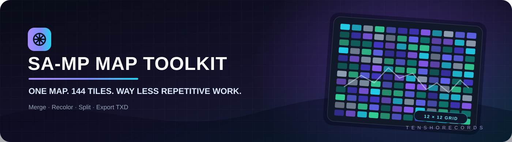
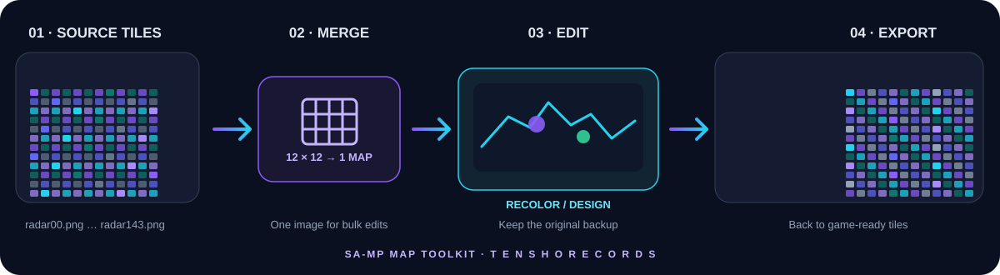

<div align="center">



# SA-MP Map Toolkit

### One map. 144 tiles. Way less repetitive work.

A small set of tools for the **GTA: San Andreas Multiplayer (SA-MP) mapping workflow**. Merge a 12 × 12 radar tile set into one image, recolor it, split it back into 144 tiles, and convert radar PNGs to TXD.

[](.github/workflows/windows-build.yml)
[](.github/workflows/android-build.yml)
[](src/)
[](#the-144-tile-workflow)

**Built by Tensho Records · Made to make map editing faster.**

[فارسی](docs/README_FA.md) · [Build guide](docs/BUILDING.md) · [Report a bug](https://github.com/xtenshow/samp-map-toolkit/issues)

</div>

---

## Why this toolkit?

A common SA-MP map workflow is split into **144 individual radar tiles**. Editing every tile by hand is repetitive and slow. SA-MP Map Toolkit lets you do broad changes on a single combined map, then export it into the tile layout again.

<div align="center">

</div>

## Tools

| Tool | What it does |
|---|---|
| **Merge Tiles** | Combines `radar00.png` through `radar143.png` into one map image. |
| **Split Map** | Cuts a map into a 12 × 12 set of numbered tiles. |
| **Color Studio** | Samples a target color and replaces it, with a live preview, RGB controls, hue selection, and tolerance. |
| **PNG → TXD** | Converts radar PNG images to RenderWare TXD textures for GTA SA. |

## The 144-tile workflow

1. **Back up the original tiles.** Keep a copy before overwriting or replacing any map assets.
2. **Select the input folder.** The default naming scheme is `radar00.png` … `radar143.png`.
3. **Merge the tiles.** With the default 256 × 256 tile size, the combined image is 3072 × 3072 pixels.
4. **Edit the full map.** Use your image editor for larger design changes, or use Color Studio for color replacement.
5. **Split it back into tiles.** Keep the original dimensions and use vertical flip only when your source tile order is bottom-up.
6. **Convert if needed.** Use PNG → TXD when your game/mod workflow needs TXD textures.

## Get the app

### Windows

The Windows executable is built automatically by GitHub Actions from the Python source—generated binaries are not committed to the source tree.

1. Open **[Actions → Build Windows EXE](https://github.com/xtenshow/samp-map-toolkit/actions/workflows/windows-build.yml)**.
2. Open the latest successful run.
3. Download the **`RadarTool-Windows-EXE`** artifact and extract it.
4. Run `RadarTool.exe`.

To run directly from source, install Python 3.10+ and then:

```powershell
python -m venv .venv
.\.venv\Scripts\Activate.ps1
python -m pip install -r requirements-windows.txt
python src/windows/Radar_Tool_v8_DPI_Responsive.py
```

### Android

The Android/Kivy source is in `src/android/`. An Actions workflow builds a debug APK:

1. Open **[Actions → Build Android APK](https://github.com/xtenshow/samp-map-toolkit/actions/workflows/android-build.yml)**.
2. Open a completed run and download **`RadarTool-Android-APK`**.
3. Install the APK for testing.

The Android version is still experimental. A successful build does **not** guarantee every folder provider and file operation works on every phone; test file picking, merge, split, TXD export, and color saving before relying on it for important map assets.

## Repository structure

```text
samp-map-toolkit/
├── assets/
│   └── banner.svg
├── docs/
│   ├── 144-tile-workflow.svg
│   ├── BUILDING.md
│   └── README_FA.md
├── src/
│   ├── windows/
│   │   └── Radar_Tool_v8_DPI_Responsive.py
│   └── android/
│       ├── main.py
│       ├── android_storage.py
│       └── buildozer.spec
├── .github/workflows/
│   ├── windows-build.yml
│   └── android-build.yml
├── requirements-windows.txt
├── CHANGELOG.md
└── README.md
```

All application source is kept under **`src/`**, separated by platform. The workflows publish downloadable build artifacts without adding generated APKs or EXEs to Git history.

## Important notes

- Expected tile filenames: `radar00.png` … `radar143.png`.
- Back up map assets before splitting or exporting over existing files.
- No license has been selected yet. Until a license is added, don't assume permission to redistribute or relicense the code.
- Windows and Android tools are provided as a community-oriented project; verify output in your own SA-MP setup before publishing it to a live server.

## Contributing

Bug reports, feature ideas, and pull requests are welcome. When reporting a problem, include the platform, the action you took, and the full error message or a screenshot. Avoid sharing private maps or assets unless you have permission.

---

<div align="center">

**SA-MP Map Toolkit** · Merge less manually. Build maps more creatively.

</div>
